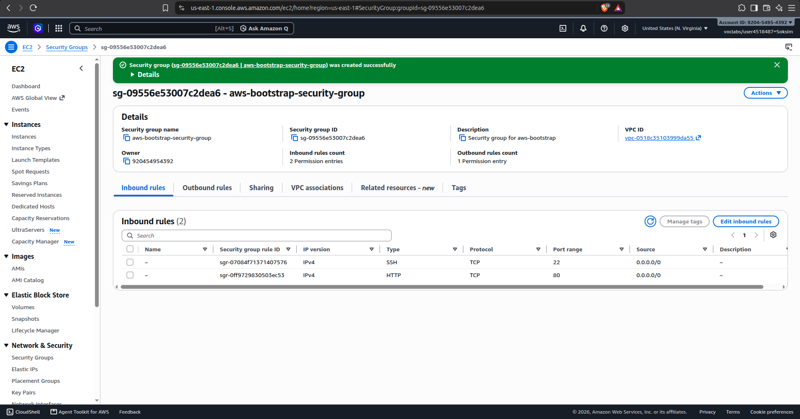
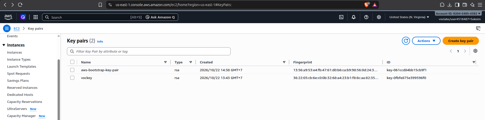
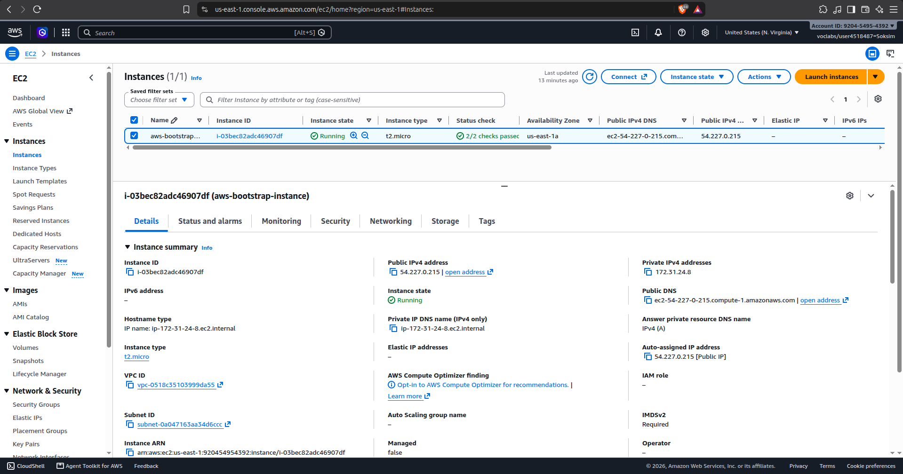
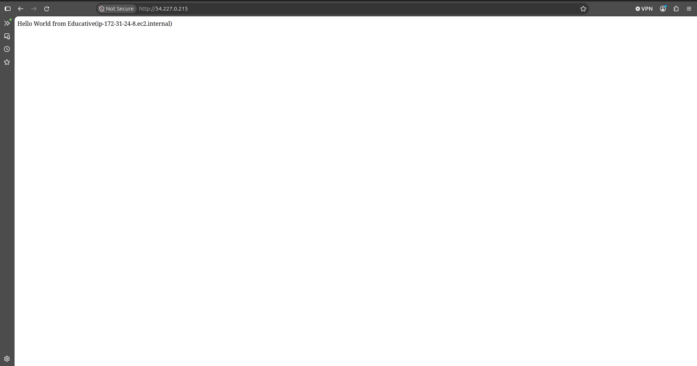
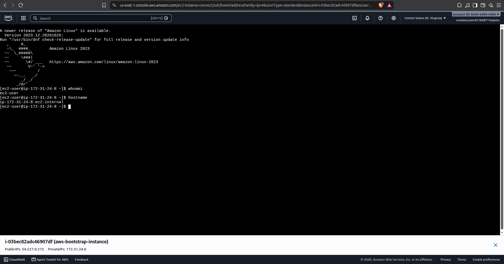
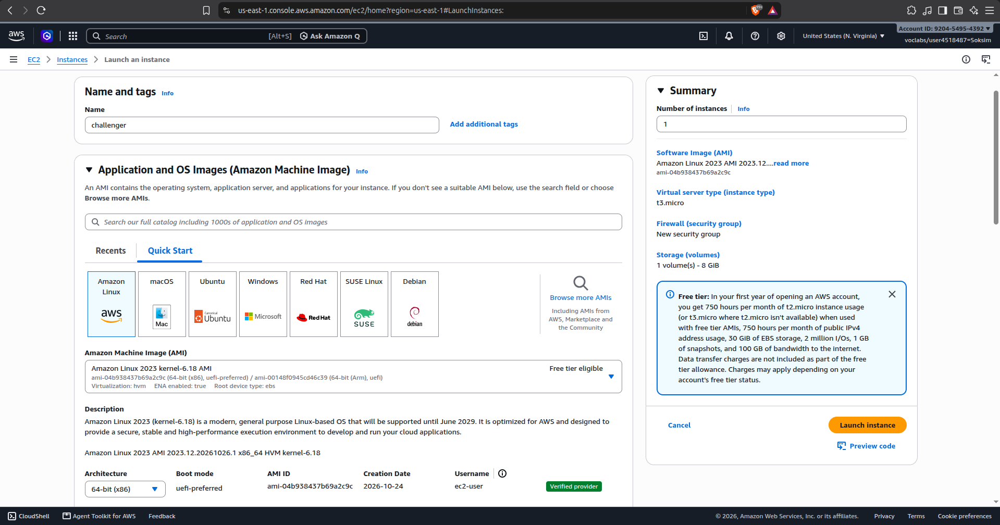
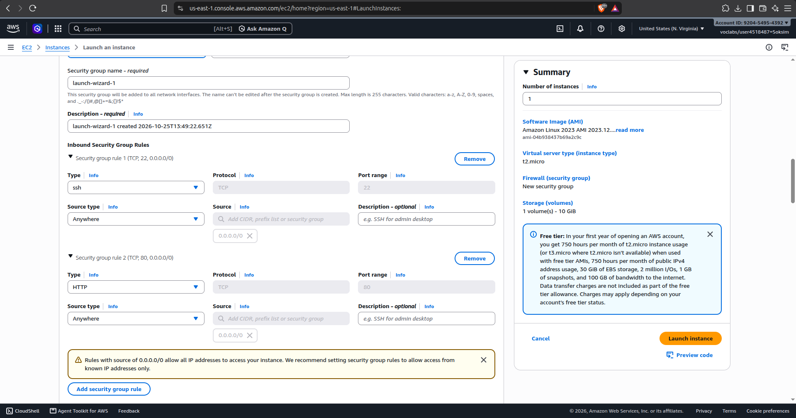
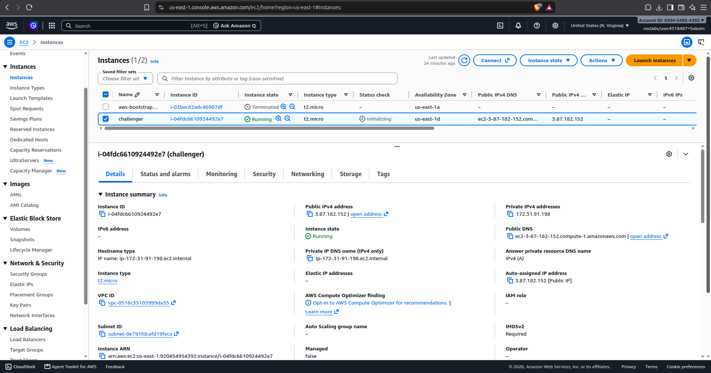
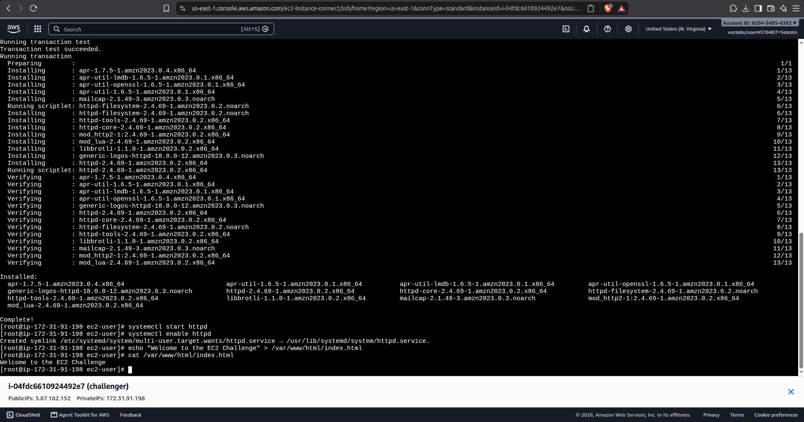
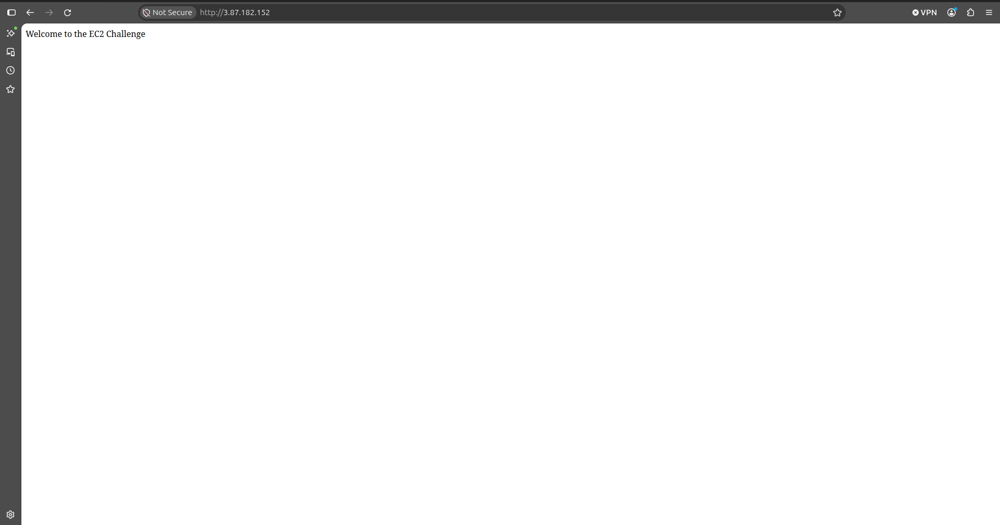

# Cloud Lab 1 Submission — Amazon EC2

- **Student name: Bunarith Soksim**
- **Student ID: e20220473**
- **Learner Lab user name: Soksim**
- **Date completed: 25 October 2026**

---

## Part 1.1 — An Amazon EC2 Walkthrough

### Security group



### Key pair



### Instance details



### Browser test



### SSH connection



Did you connect with your own SSH client or with EC2 Instance Connect?

---

## Part 1.2 — EC2 Web Solution (Challenge)

### Launch configuration



### Security group



### Running instance



### Commands on the instance



Paste the commands you ran to install the web server and create `index.html`:

```bash

```

### Browser test



---

## Questions

1. **Your security group has an SSH rule and an HTTP rule. What does each one let you do? What would stop working if you deleted the HTTP rule?**
   - **SSH rule (port 22):** Allows inbound Secure Shell connections, enabling remote command-line administration either from a local terminal client using a private key (`.pem`) or via browser-based EC2 Instance Connect.
   - **HTTP rule (port 80):** Allows standard, unencrypted inbound web traffic, enabling external web browsers to reach the Apache (`httpd`) web server and view web pages.
   - **If the HTTP rule was deleted:** Web browsers would no longer be able to connect to the instance on port 80; attempts to load `http://<Public-IP>` would time out. However, SSH administrative access on port 22 would remain unaffected.

2. **In Part 1.1 you never logged in to install the web server. What installed it, and when did it run?**
   - It was installed by the **User data** shell script supplied under the **Advanced details** section during instance launch.
   - It ran automatically with root privileges via `cloud-init` during the **initial boot cycle** immediately after the instance was provisioned.

3. **Why does the web page open with `http://` but not with `https://`?**
   - The web server was configured to listen only on port 80 (HTTP) without an SSL/TLS certificate installed or configured.
   - Additionally, the security group only allowed inbound traffic on port 80 (HTTP) and port 22 (SSH); port 443 (HTTPS) was neither open in the security group nor handled by Apache.

4. **Part 1.2 asked for a 10 GiB root volume. Where in the launch settings did you set it, and how can you check the size on the running instance?**
   - **In Launch Settings:** Configured under the **Configure storage** section by modifying the root EBS volume size from the default `8 GiB` to `10 GiB` (`gp3`).
   - **On the Running Instance:** You can verify it from the terminal using the commands:
     - `lsblk` (displays block device sizes, showing `xvda` or `nvme0n1` as 10G)
     - `df -h /` (displays the mounted filesystem disk space usage for root)

## Problems and how I solved them (optional)

- **Issue:** Connecting via a local terminal over SSH required setting strict file permissions on the downloaded `.pem` private key, which can fail with permission errors on Windows.
- **Solution:** Used AWS **EC2 Instance Connect** directly in the browser to establish a secure, browser-based SSH terminal session without needing to manually reconfigure local key ACL permissions.

## AI note (optional)

One suggestion an AI tool gave you and how you checked it:
- The AI suggested using `dnf update -y` and `dnf install -y httpd` for manual installation in Amazon Linux 2023 instead of the older `yum` package manager. I verified this by running the commands inside the EC2 Instance Connect terminal, confirming the packages downloaded and installed successfully, and then checked service status with `systemctl status httpd` and accessed the page via browser.