# Cloud Lab 2 Submission — Load Balancer and Auto Scaling

- **Student name:** Bunarith Soksim
- **Student ID:** e20220473
- **Learner Lab user name:** voclabs/user4518487=Soksim
- **Date completed:** 2026-11-05

---

## Security groups

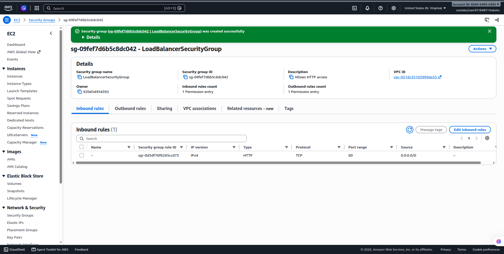

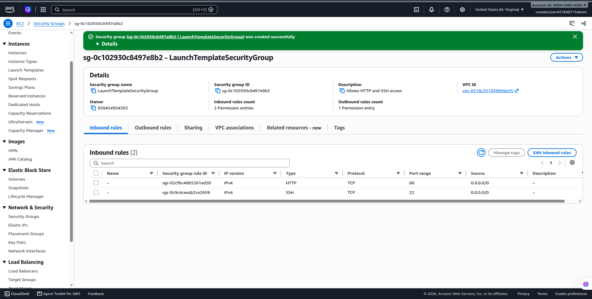

## Target group

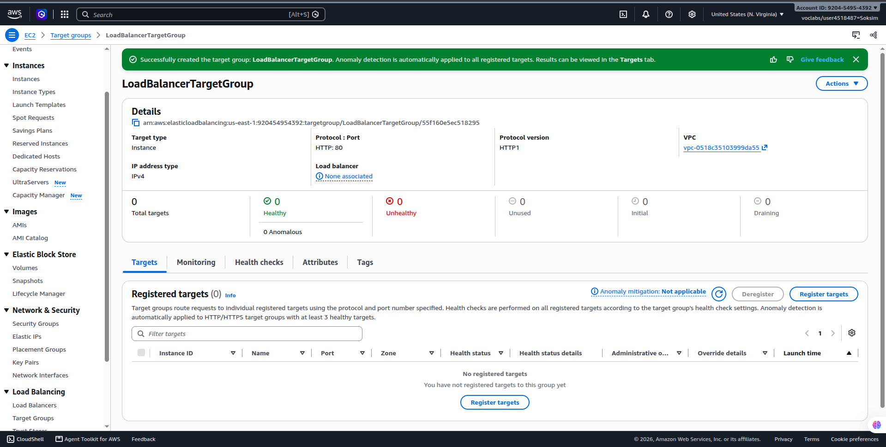

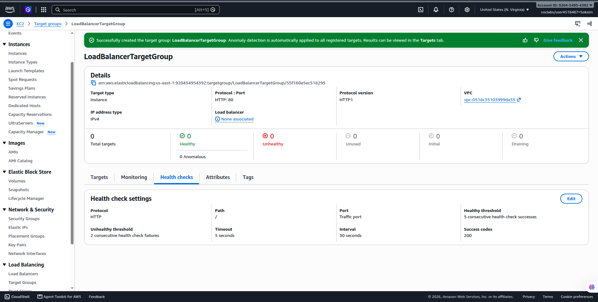

## Application Load Balancer

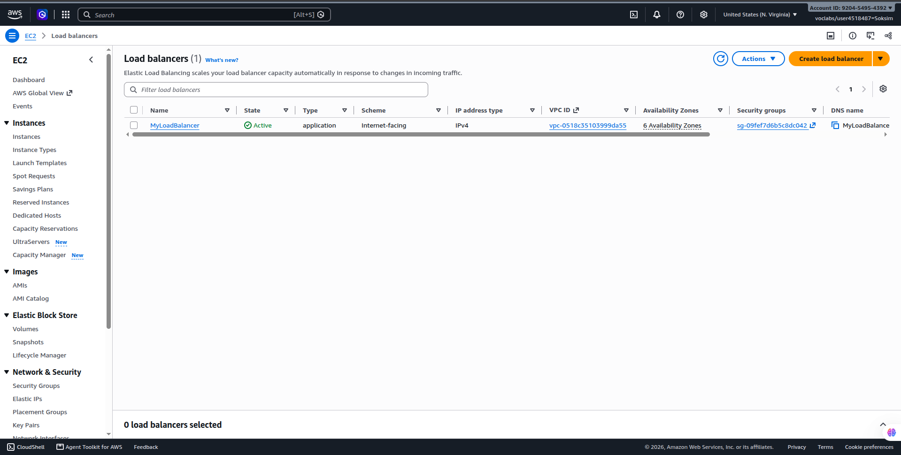

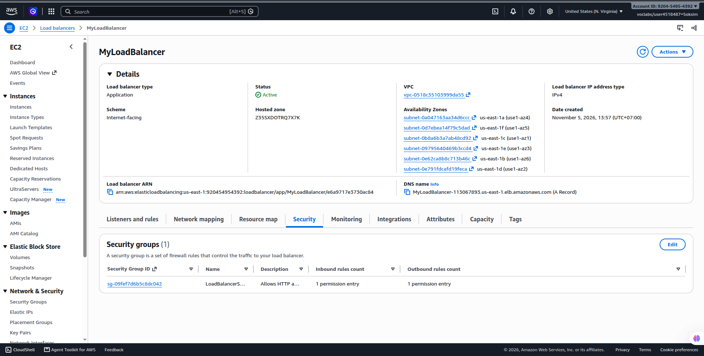

## Launch template

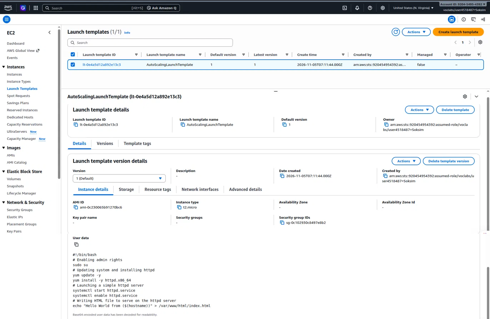

## Auto Scaling group

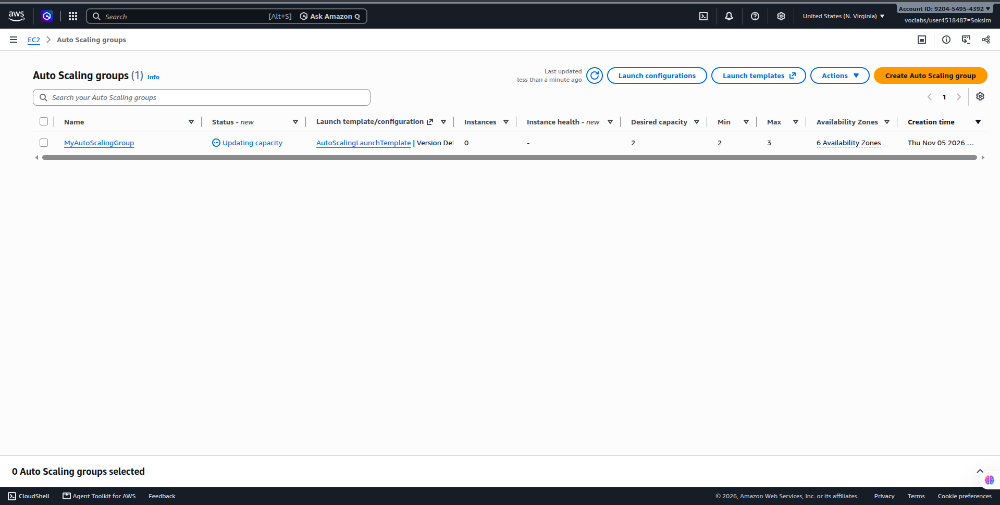

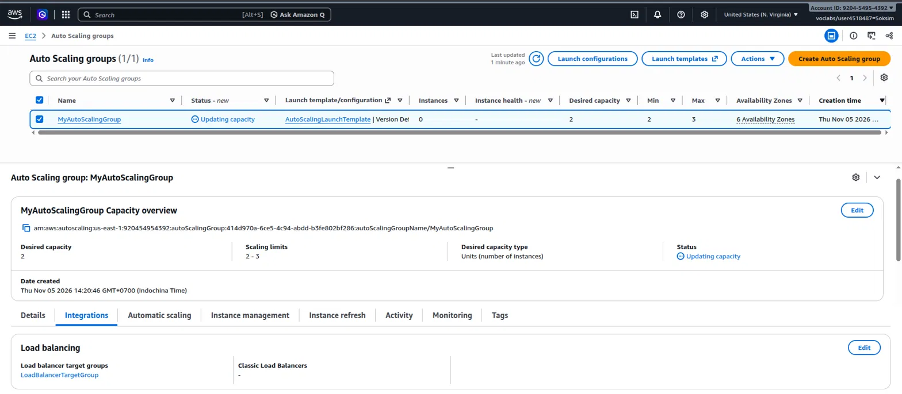

## Load balancing test

## Simulated application failure

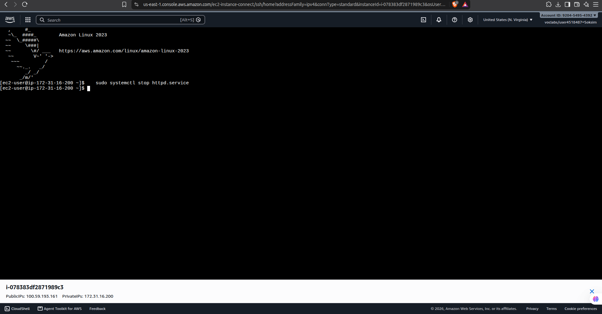

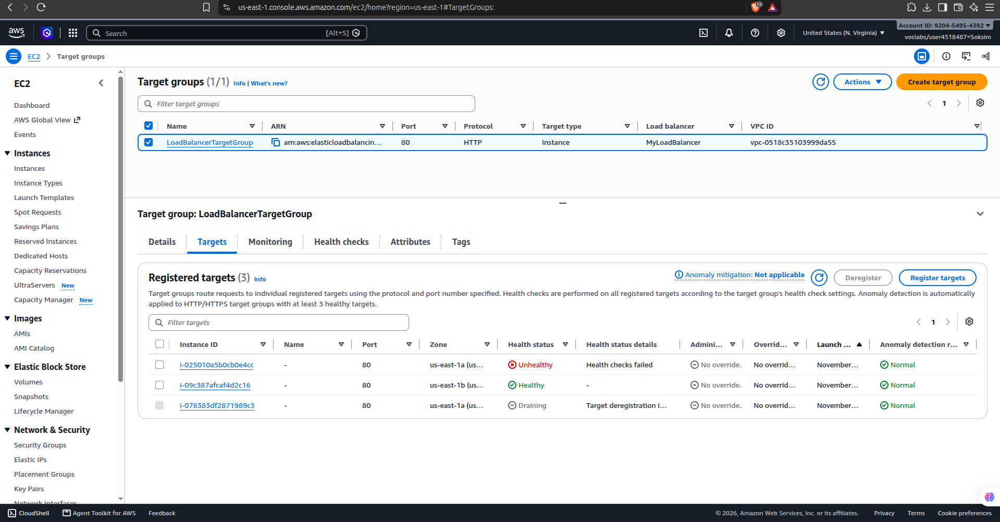

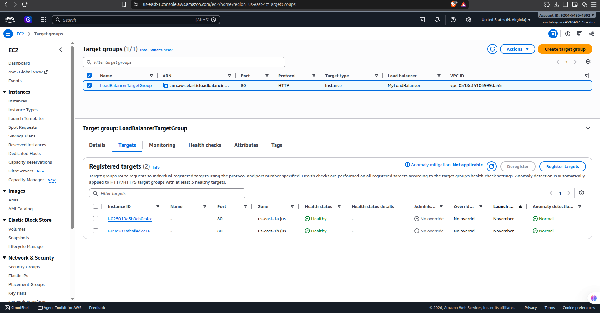

About how many minutes passed between stopping `httpd` and the new instance becoming healthy?

**About 6 minutes.** I stopped `httpd` on instance `i-078383df2871989c3` (`ip-172-31-16-200`). After two failed health checks (2 × 30 s), the target group marked it unhealthy, and then it changed to *draining*. The Auto Scaling group launched a new instance, `i-025010a5b0cb0e4cc`. That instance first needed to boot and run the user data script that installs `httpd`. Then it had to pass 5 health checks in a row (the healthy threshold, 5 × 30 s ≈ 2.5 minutes) before it became *healthy*.

---

## Questions

**1. Why does the page show a different host name when you refresh it?**

Each refresh is a new request to the load balancer. The load balancer spreads the requests over the healthy targets in `LoadBalancerTargetGroup`, so consecutive requests can go to different instances. The user data script wrote each instance's own host name into its `index.html`. That is why I saw `ip-172-31-16-200` on one request and `ip-172-31-41-199` on another.

**2. After you stopped `httpd`, the instance was still *running* in EC2, but the target group marked it *unhealthy*. What did the health check test, and why did the instance fail it?**

The health check tests the **application**, not the virtual machine. Every 30 seconds it sends an HTTP `GET /` request to port 80 on the target and expects the success code `200`. After I stopped `httpd`, nothing was listening on port 80, so the request was refused and did not return `200`. The EC2 instance itself was still running, so it passed the EC2 status checks. It failed the load balancer health check twice in a row (unhealthy threshold = 2), so the target group marked it *unhealthy* with the reason "Health checks failed".

**3. Who replaced the failed instance: the load balancer, the target group, or the Auto Scaling group? Explain the role of each one.**

The **Auto Scaling group** replaced it.

- **Load balancer (`MyLoadBalancer`):** the single entry point for clients. Its listener (HTTP:80) receives the requests and forwards them only to healthy targets in the target group. Once a target is unhealthy, it stops sending traffic to it.
- **Target group (`LoadBalancerTargetGroup`):** holds the registered instances and runs the health checks on them. It reports each target's state (*initial*, *healthy*, *unhealthy*, *draining*). It does not create or terminate instances.
- **Auto Scaling group (`MyAutoScalingGroup`):** keeps the number of running instances equal to the desired capacity (2). Because ELB health checks are enabled, it uses the target group's result. When `i-078383df2871989c3` became unhealthy, the Auto Scaling group terminated it. It then launched `i-025010a5b0cb0e4cc` from `AutoScalingLaunchTemplate` and registered the new instance in the target group automatically.

**4. With desired 2, minimum 2 and maximum 3, how many instances run normally? In what situation could there be 3?**

Normally **2** instances run, the desired capacity. There could be 3 in these situations:

- A scaling policy increases the desired capacity when the load is high, for example when average CPU utilization or the request count per target goes above a threshold.
- Someone raises the desired capacity to 3 by hand.
- For a short time during a replacement or instance refresh, when a new instance starts before the old one is fully terminated. Screenshot 13 shows 3 registered targets for this reason.

The group can never have more than 3 instances (the maximum) or fewer than 2 (the minimum).

**5. The instances' security group allows HTTP from anywhere. How could you change it so that the instances accept HTTP only from the load balancer?**

Edit the inbound HTTP (port 80) rule of `LaunchTemplateSecurityGroup` and change its **source** from `0.0.0.0/0` to the security group `LoadBalancerSecurityGroup`. A security-group reference allows traffic only from network interfaces that have that security group, which here means only the load balancer. Users can still reach the website through the load balancer's DNS name. They can no longer reach port 80 on an instance's public IP directly.

## Problems and how I solved them

- **Screenshots 07 and 09 did not fit on one screen.** The launch template's instance details and its user data are far apart on the page. The Auto Scaling group's capacities and its target group are on different tabs. For each one I took two screenshots and combined them into a single image.
- **The new instance appeared as *Unhealthy* at first** (screenshot 13). It was still booting and installing `httpd`, so its first health checks failed. After the user data script finished and it passed 5 health checks in a row, it became *Healthy* (screenshot 14).

## Clean up

- [x] `MyAutoScalingGroup` deleted and its instances terminated.
- [x] `AutoScalingLaunchTemplate` deleted.
- [x] `MyLoadBalancer` and `LoadBalancerTargetGroup` deleted.
- [x] Both security groups deleted.