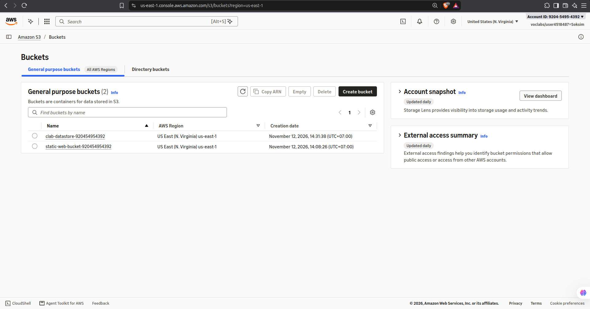
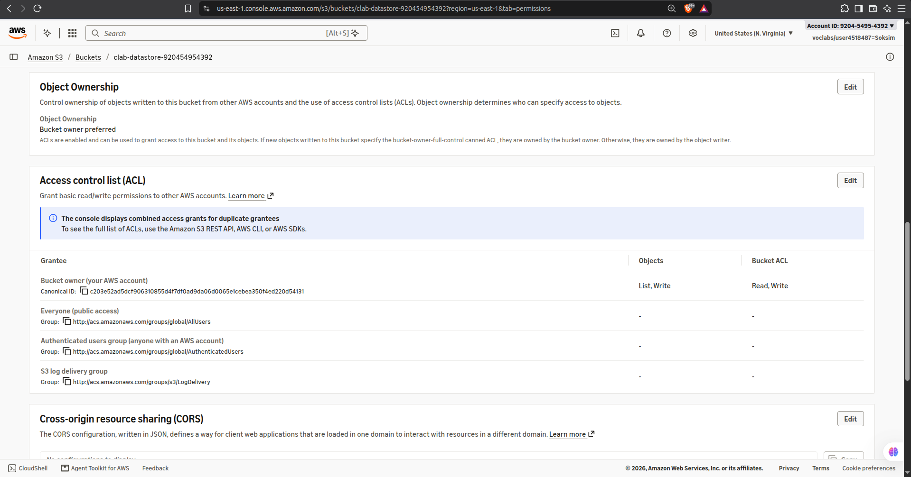
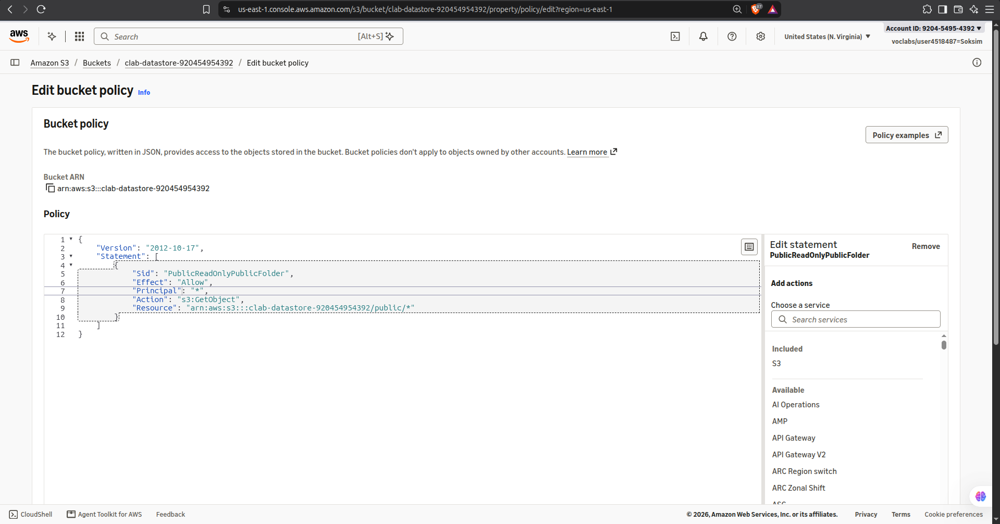
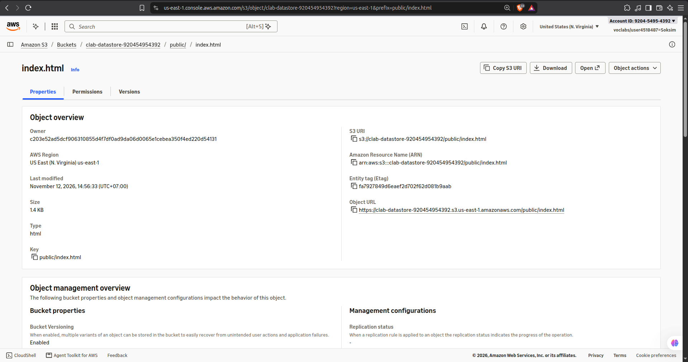
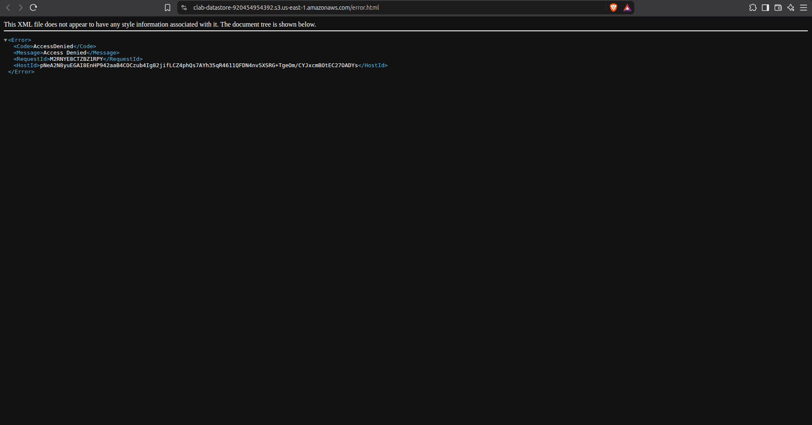
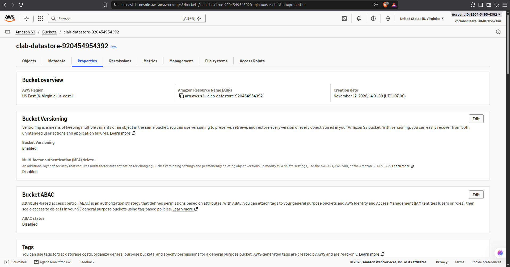
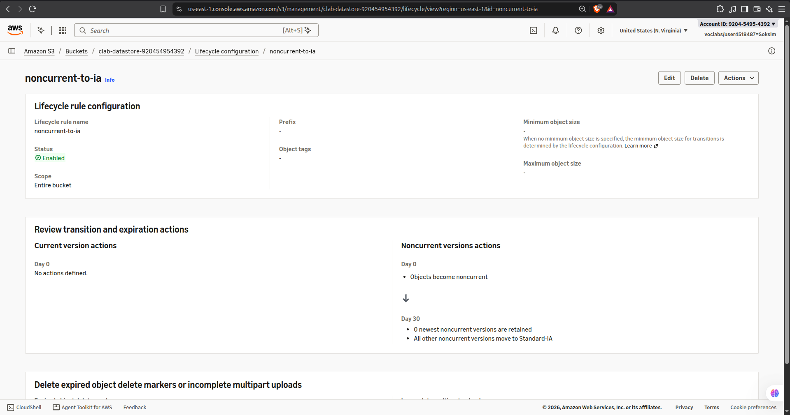

# Cloud Lab 3 Challenge Submission — Secure S3 Bucket

- **Student name:** Bunarith Soksim
- **Student ID:** e20220473
- **Learner Lab user name:** voclabs/user4518487=Soksim
- **Bucket name:** clab-datastore-920454954392
- **Date completed:** 12 Nov 2026

---

## 1. Bucket

I created the bucket `clab-datastore-920454954392` in **US East (N. Virginia) us-east-1**. I added my AWS account ID to the name because bucket names must be globally unique.



## 2. Object ownership

Object Ownership is set to **Bucket owner preferred** with **ACLs enabled**, so the bucket owner manages all objects in the bucket.



## 3. Public access policy



`public/index.html` opened through its **object URL** (`https://clab-datastore-920454954392.s3.us-east-1.amazonaws.com/public/index.html`) loads in the browser:



`error.html`, uploaded to the bucket root, returns **AccessDenied** through its object URL:



My policy is in [bucket-policy.json](bucket-policy.json). Explain which line limits public access to the `public/` folder:

The line that limits access is:

```json
"Resource": "arn:aws:s3:::clab-datastore-920454954392/public/*"
```

The policy allows `s3:GetObject` for everyone (`"Principal": "*"`), but only on objects whose key starts with `public/`. The `/*` after `public` matches every object inside that folder. Objects at the root or under any other prefix do not match this resource, so the policy never grants access to them.

## 4. Versioning

Bucket Versioning is **Enabled**, so S3 keeps the older versions of an object when it is overwritten or deleted.



## 5. Lifecycle rule

The rule `noncurrent-to-ia` applies to the **entire bucket** and moves **noncurrent versions** to **S3 Standard-IA 30 days** after they become noncurrent.



---

## Questions

1. **You turned off parts of Block Public Access for this bucket. Why was that needed, and why is it still safe for the objects outside `public/`?**

   Block Public Access overrides every other setting. With it fully on, S3 rejects any bucket policy that grants public access, so my policy for `public/*` could not be saved or would not work. I turned off only the two settings about **public bucket policies** and kept the two **ACL** settings on, so nobody can make objects public through ACLs.

   It is still safe for the other objects because S3 **denies everything by default**. Turning off Block Public Access does not make anything public by itself. Only what a policy explicitly allows becomes public, and my policy only allows `s3:GetObject` on `public/*`. I tested this: `error.html` at the root returned **AccessDenied**.

2. **What is a noncurrent version? Give an example from your own test.**

   When versioning is enabled and you upload an object with the same key again, the new upload becomes the **current version**. The old one is kept as a **noncurrent version**. It is no longer returned by default, but it still exists and can be restored.

   In my test, I uploaded `public/index.html`, then edited the text in VS Code and uploaded it again to the same key. With **Show versions** turned on, S3 listed two versions of `public/index.html`. The newer one is the current version, and the first upload became a noncurrent version.

3. **Why move noncurrent versions to S3 Standard-IA instead of deleting them?**

   The content team wants old versions kept so they can track changes or restore a page after a mistake. Deleting the versions would lose that history. Old versions are rarely read, and **Standard-IA** (Infrequent Access) costs less per GB than S3 Standard while keeping the data just as durable and available in milliseconds. You pay a small fee only when you read it, so it suits data that is kept "just in case." Waiting 30 days also fits Standard-IA's 30-day minimum storage charge.

## AI note (optional)

The AI told me to test the public object by clicking the **Object URL** link and not the **Open** button. The Open button uses a temporary pre-signed URL, so it would load the page even without a public policy. I checked this by opening the object URL of `error.html` at the bucket root: it returned **AccessDenied**, while `public/index.html` loaded. This shows that only the bucket policy was making the `public/` object readable.

## Clean up

- [x] All object versions deleted and the bucket deleted.