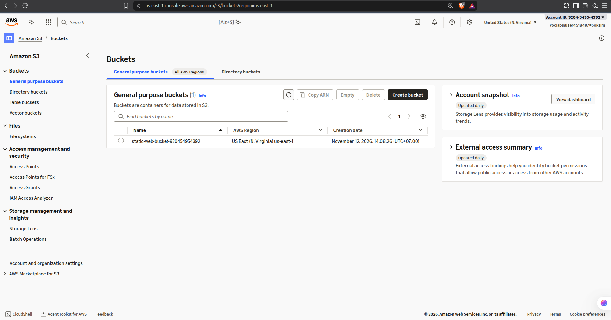
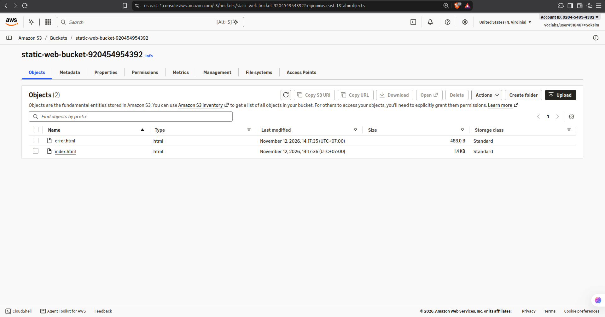
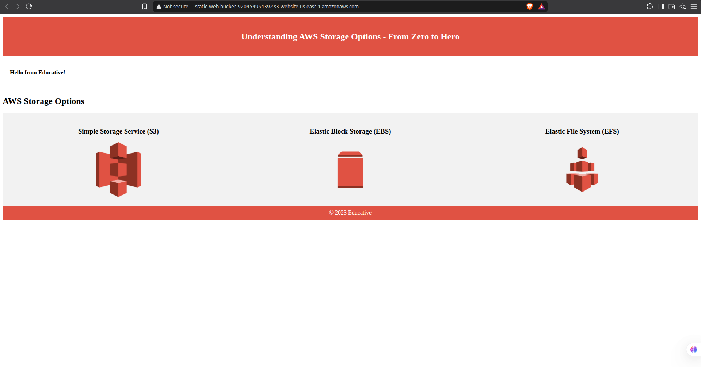
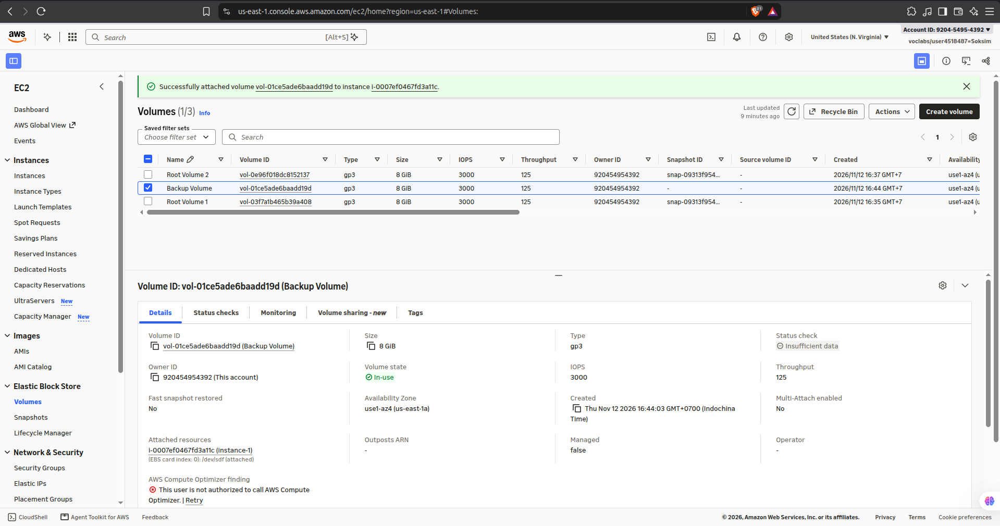
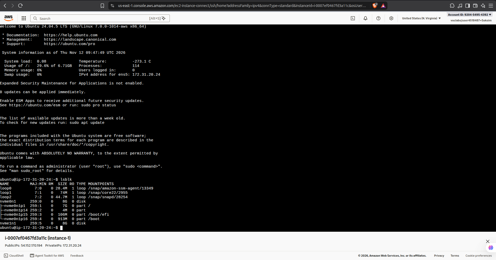
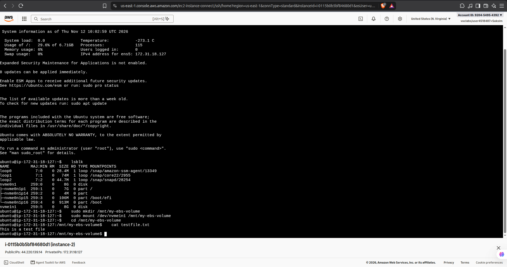
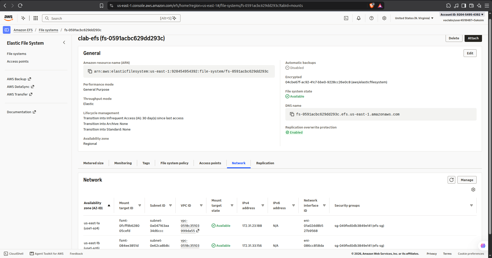
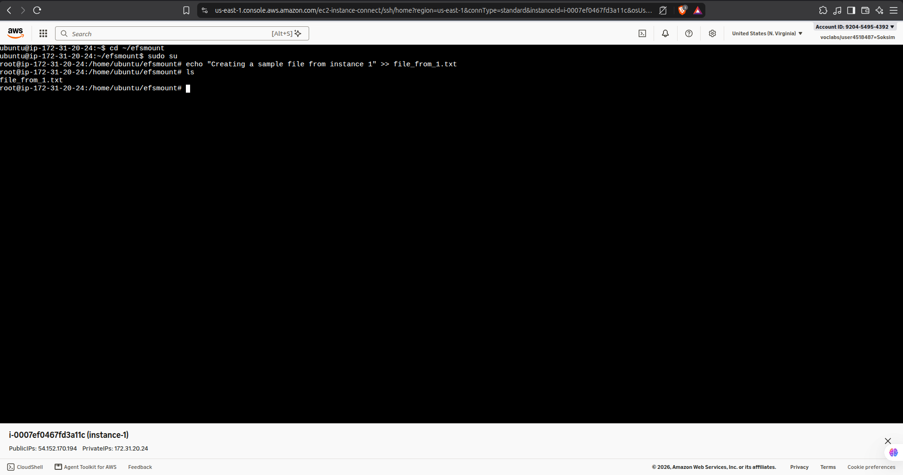
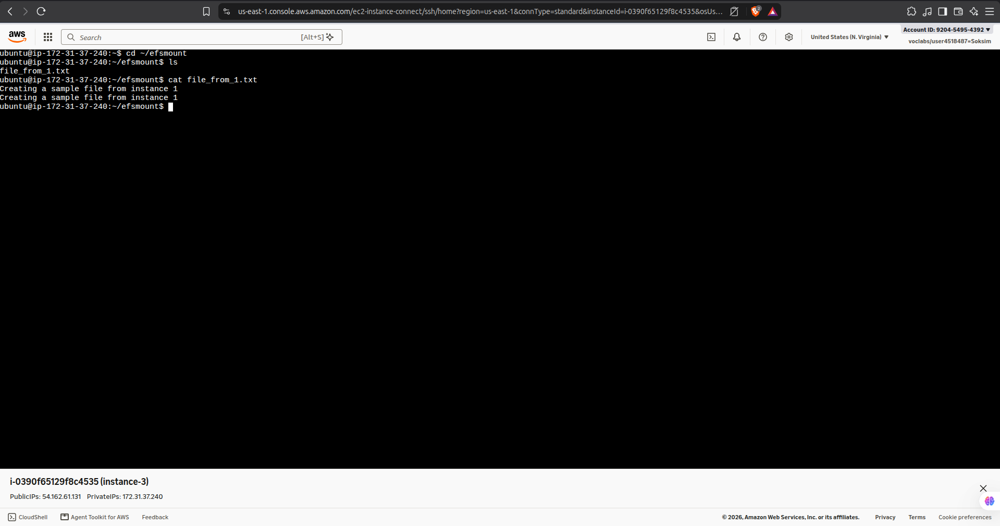

# Cloud Lab 3 Submission — AWS Storage Options

- **Student name:** Bunarith Soksim
- **Student ID:** e20220473
- **Learner Lab user name:** voclabs/user4518487=Soksim
- **Date completed:** 12 Nov 2026

---

## Part 2.1 — Amazon S3

### Bucket list

I created the bucket `static-web-bucket-920454954392` in **us-east-1**, with **Block all public access** turned off.

### Uploaded files

`index.html` and `error.html` uploaded to the root of the bucket.

### Static website

After enabling static website hosting and adding a bucket policy, the website endpoint shows `index.html`.

---

## Part 2.2 — Amazon EBS

### Volumes page

**Backup Volume** (gp3, 8 GiB, us-east-1a) is **In-use**, attached to `instance-1` as `/dev/sdf`.

### Attached volume (`lsblk`)

Which device name did your volume get (`xvdf`, `nvme1n1`, ...)?

**`nvme1n1`**. I attached it as `/dev/sdf`, but `t3` instances use NVMe, so Linux shows EBS volumes as NVMe devices. The root volume is `nvme0n1` (with partitions and mounted at `/`), and my Backup Volume is `nvme1n1` (8G, no partitions, no mount point).

### File read on instance-2

After unmounting on `instance-1`, detaching, and attaching to `instance-2`, I mounted the volume (without `mkfs`) and `testfile.txt` was still there.

---

## Part 2.3 — Amazon EFS

### File system and mount targets

`clab-efs` (`fs-0591acbc629dd293c`) with two mount targets, in **us-east-1a** and **us-east-1b**, both using the security group `efs-sg`.

### File created on instance-1

### File listed on instance-3

`instance-3` (us-east-1b) sees `file_from_1.txt`, which was created on `instance-1` (us-east-1a).

---

## Questions

1. **After you turned on static website hosting, the endpoint first answered 403 Forbidden. Why, and what changed after you added the bucket policy?**

   S3 denies all access by default. Turning off Block Public Access only *allows* the bucket to become public; it does not grant anyone permission. When I opened the endpoint, the request came from an anonymous user, and no policy allowed that user to read the objects, so S3 returned **403 Forbidden**. The bucket policy added an `Allow` for `s3:GetObject` to `Principal: "*"` (everyone) on `arn:aws:s3:::static-web-bucket-920454954392/*` (every object in the bucket). After that, anonymous users could read `index.html`, and the website loaded.

2. **`testfile.txt` was still there after you moved Backup Volume to `instance-2`. What would have happened to a file saved on `instance-1`'s root volume after terminating `instance-1`?**

   The file would be **lost**. A root volume is created with the instance and, by default, has *Delete on termination* turned on, so it is deleted when the instance is terminated. Backup Volume was an **additional** volume that I created separately, so it exists independently of any instance and keeps its data after detaching or terminating.

3. **Why did you run `mkfs` on `instance-1` but not on `instance-2`?**

   A new EBS volume is raw, unformatted block storage, so on `instance-1` I had to create an `ext4` file system with `mkfs` before I could mount it and save files. On `instance-2`, the volume already had that file system and my `testfile.txt`. Running `mkfs` again would have created a new empty file system and **erased** the data, so I only mounted it.

4. **Why could `instance-1` and `instance-3` use the EFS file system at the same time, when an EBS volume had to be detached first? Why did they have to be in the subnets of the mount targets?**

   EFS is a **shared network file system** that uses the NFS protocol. Many clients can mount it at the same time, and EFS handles file locking and consistency. A normal EBS volume is **block storage** that behaves like a physical disk attached to one instance, so it has to be detached before another instance can use it (and it can only be used in its own Availability Zone).

   Instances reach EFS through **mount targets**. Each mount target has an IP address in one subnet/AZ, and the EFS DNS name resolves to the mount target in the instance's own AZ. `instance-1` is in us-east-1a and `instance-3` is in us-east-1b, so each one needed a mount target in its AZ. When the us-east-1b mount target was not ready, `instance-3` could not even resolve the file system's DNS name. The mount targets also needed the `efs-sg` security group so that NFS traffic (port 2049) was allowed in.

5. **For each need, choose S3, EBS or EFS and give one reason:**
   - **(a) A website's images → S3.** Images are static objects that can be served directly over HTTP from a URL, S3 scales without limit, and it is cheap for storing many files.
   - **(b) The disk of a database server → EBS.** A database needs low-latency block storage attached to one server, and EBS offers types like gp3 or Provisioned IOPS (io1/io2) for fast, consistent I/O.
   - **(c) A folder shared by several web servers → EFS.** Many instances can mount the same EFS file system at the same time, across Availability Zones, and see the same files.

## Problems and how I solved them (optional)

- **Device name was not `xvdf`.** The instructions show `/dev/xvdf`, but on `t3` instances the volume appeared as `nvme1n1` in `lsblk`. I used `/dev/nvme1n1` in the `mkfs` and `mount` commands.
- **Pasting several commands at once after `sudo su`.** When I pasted all the commands together, `sudo su` opened a new root shell and the lines after it did not run, so `testfile.txt` was not created. I ran the remaining commands one line at a time as root and checked with `cat testfile.txt`.
- **Volume could not be attached right away.** "Attach volume" was greyed out while the volume state was *Creating*, and later while it was *detaching*. I refreshed the Volumes page until the state was **Available**.
- **`build-deb.sh` failed.** The current `efs-utils` (v3.3.5) failed with `failed to parse lock file ... lock file version 4 requires -Znext-lockfile-bump`, because the Rust/Cargo version installed by `apt` on Ubuntu 24.04 is too old. I ran `git checkout v1.36.0` (an older version that does not need Rust), and the build and install worked.
- **`mount point efsmount/ does not exist`.** I ran the mount command from the wrong folder. I ran `cd ~` first so the relative path `efsmount/` pointed to `/home/ubuntu/efsmount`.
- **EFS mount failed on instance-3 and hung on instance-1.** `instance-3` showed `Failed to resolve fs-0591acbc629dd293c.efs.us-east-1.amazonaws.com`, and the mount on `instance-1` did not respond. I checked the **Network** tab of `clab-efs` and made sure there was an **Available** mount target in both **us-east-1a** and **us-east-1b**, each with the `efs-sg` security group. After that, `sudo mount -t efs fs-0591acbc629dd293c efsmount/` worked on both instances, and `df -h | grep efs` showed the mount.

## AI note (optional)

When `build-deb.sh` failed, the AI suggested the error came from the old Rust version on Ubuntu 24.04 and told me to build an older `efs-utils` release (`v1.36.0`) instead. I checked by reading the error message (it said the `Cargo.lock` version 4 was not supported), then building v1.36.0. It finished without errors, and the `mount -t efs` command worked, which I confirmed with `df -h | grep efs`.

## Clean up

- [x] Instances `instance-1`, `instance-2`, `instance-3` terminated.
- [x] `clab-efs` and **Backup Volume** deleted.
- [x] Security groups `efs-sg` and `ec2instances-sg` deleted.
- [x] S3 bucket emptied and deleted.