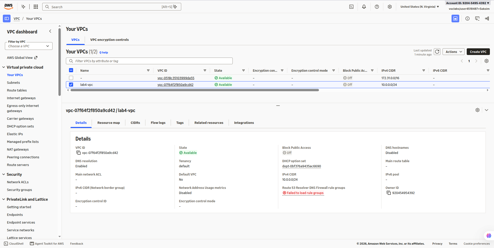
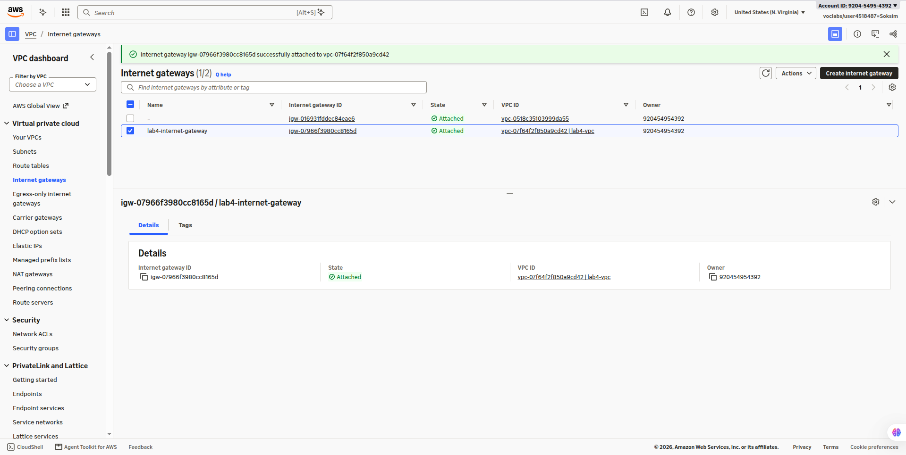
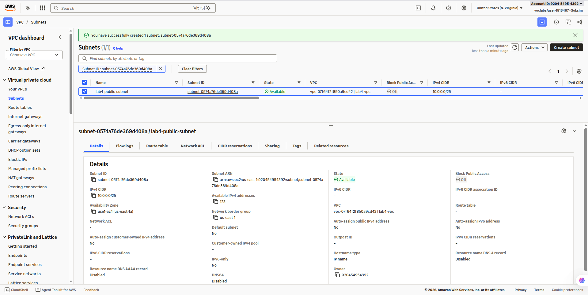
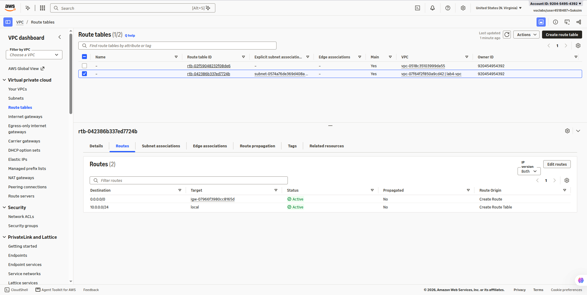
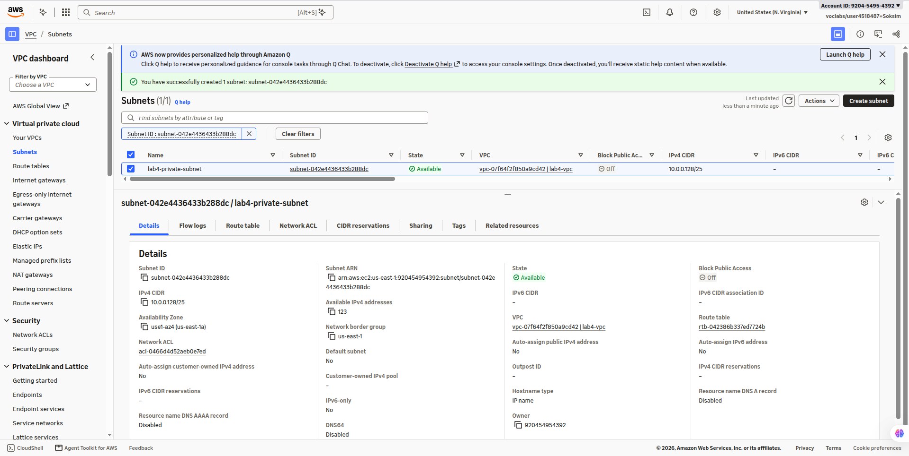
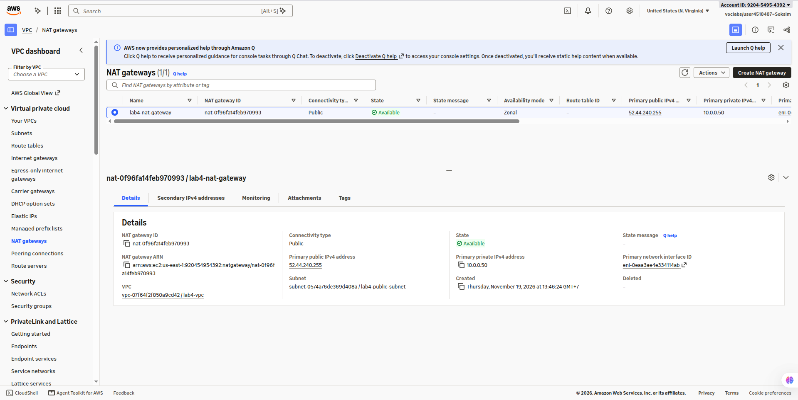
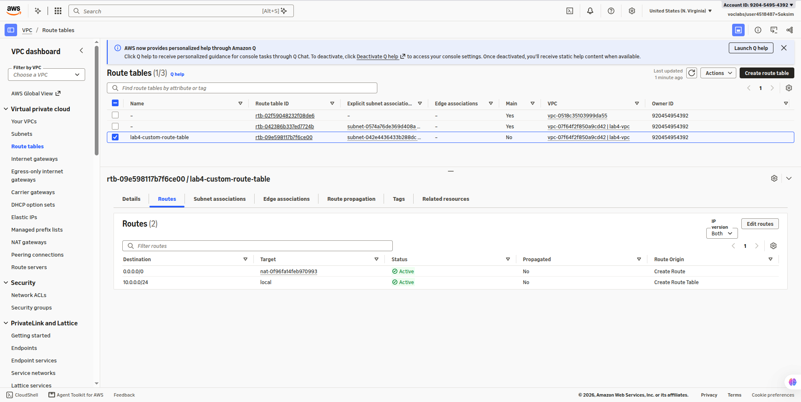
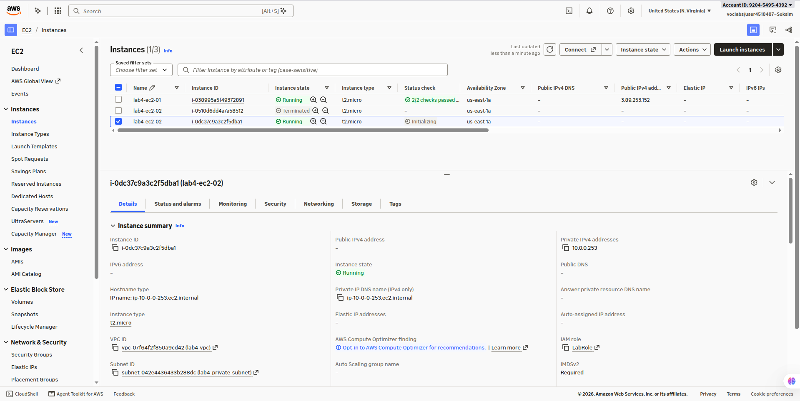
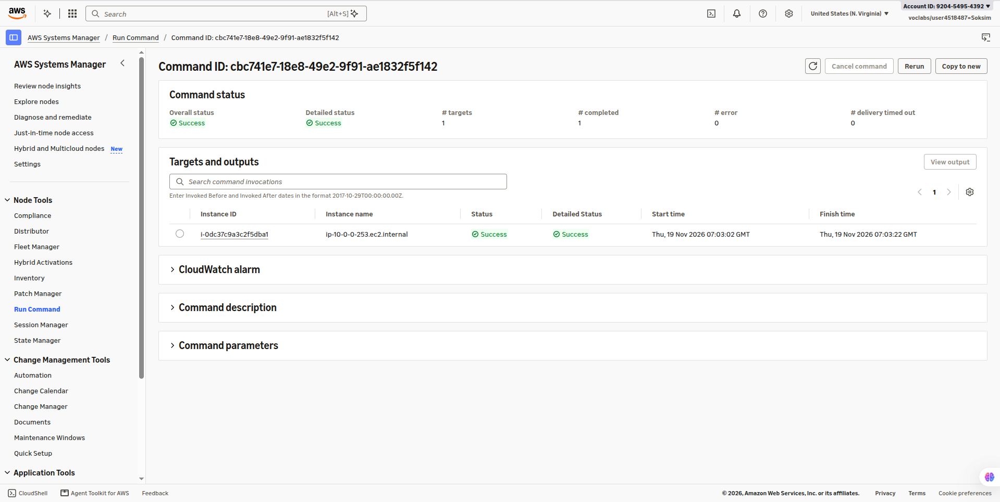

# Cloud Lab 4 Submission — Amazon VPC with Public and Private Subnets

- **Student name:** Bunarith Soksim
- **Student ID:** e20220473
- **Learner Lab user name:** voclabs/user4518487=Soksim
- **Date completed:** 19 November 2026
- **Region:** US East (N. Virginia) `us-east-1`

---

## Part 1 — Create a VPC with an Internet Gateway

### Task 1 — VPC

`lab4-vpc` (`vpc-07f64f2f850a9cd42`) with IPv4 CIDR `10.0.0.0/24`.



### Task 2 — Internet gateway

`lab4-internet-gateway` (`igw-07966f3980cc8165d`) is *Attached* to `lab4-vpc`.



---

## Part 2 — Test the Internet via a Public Subnet

### Task 3 — Public subnet

`lab4-public-subnet` (`subnet-0574a76de369d408a`) in `us-east-1a` with CIDR `10.0.0.0/25`.



### Task 4 — Route table

The VPC's main route table (`rtb-042386b337ed7724b`) has the route `0.0.0.0/0` → `lab4-internet-gateway` and is explicitly associated with `lab4-public-subnet`.

| Destination | Target |
|---|---|
| `10.0.0.0/24` | `local` |
| `0.0.0.0/0` | `igw-07966f3980cc8165d` |



### Task 5 — EC2 instance in the public subnet

`lab4-ec2-01` (`i-038995a5f49372891`) is running in `lab4-public-subnet` with private IP `10.0.0.17` and public IP `3.89.253.152`. It uses the instance profile `LabInstanceProfile` (role `LabRole`).


### Task 6 — Test the internet with Systems Manager

Run Command with the document `AWS-RunShellScript`:

```bash
sudo yum update -y
```

Status and Detailed Status: **Success**, so the public instance reached the internet through the internet gateway.


---

## Part 3 — Test the Internet via a Private Subnet

### Task 7 — Private subnet

`lab4-private-subnet` (`subnet-042e4436433b288dc`) in `us-east-1a` with CIDR `10.0.0.128/25`.



### Task 8 — NAT gateway

`lab4-nat-gateway` (`nat-0f96fa14feb970993`) is *Available* in `lab4-public-subnet`, with Elastic IP `52.44.240.255` and private IP `10.0.0.50`.



### Task 9 — Custom route table

`lab4-custom-route-table` (`rtb-09e598117b7f6ce00`) is associated with `lab4-private-subnet`.

| Destination | Target |
|---|---|
| `10.0.0.0/24` | `local` |
| `0.0.0.0/0` | `nat-0f96fa14feb970993` |



### Task 10 — EC2 instance in the private subnet

`lab4-ec2-02` (`i-0dc37c9a3c2f5dba1`) is running in `lab4-private-subnet` with private IP `10.0.0.253` and **no public IP address**.



### Task 11 — Test the internet with Systems Manager

Same command (`sudo yum update -y`) on `lab4-ec2-02`. Status and Detailed Status: **Success**. The private instance reached the internet through the NAT gateway, without a public IP.



---

## Summary of the network

| Subnet | CIDR | Route table | Internet path | Instance | Public IP |
|---|---|---|---|---|---|
| `lab4-public-subnet` | `10.0.0.0/25` | main (`rtb-0423…`) | → internet gateway | `lab4-ec2-01` | `3.89.253.152` |
| `lab4-private-subnet` | `10.0.0.128/25` | `lab4-custom-route-table` | → NAT gateway → internet gateway | `lab4-ec2-02` | none |

---

## Questions

1. **What makes a subnet public or private?**
   It is the route table, not the subnet itself. A public subnet has a route `0.0.0.0/0` to an internet gateway, so its instances with a public IP can be reached from the internet and can reach it. A private subnet has no route to the internet gateway. Here its `0.0.0.0/0` route goes to a NAT gateway, so instances can start connections *out* to the internet, but nobody on the internet can start a connection *in* to them.

2. **Why must the NAT gateway be in the public subnet?**
   The NAT gateway replaces the private instance's source address with its own Elastic IP and sends the traffic on to the internet. To do that, it needs a public IP and a route to the internet gateway, and only the public subnet has that route. A NAT gateway in the private subnet would have no way out.

3. **Why did the private subnet need its own route table?**
   After Task 7, both subnets used the main route table, which sends `0.0.0.0/0` to the internet gateway. The private subnet must send that traffic to the NAT gateway instead, and one route table can only have one target for `0.0.0.0/0`. So I created `lab4-custom-route-table` and associated only the private subnet with it.

4. **How could Systems Manager run commands with no key pair and no inbound rules?**
   The SSM Agent on the instance makes outbound HTTPS connections to the Systems Manager service and asks for commands. AWS never has to connect in to the instance, so no inbound rule or SSH key is needed. The instance only needs outbound internet access (through the internet gateway or the NAT gateway) and the IAM role `LabRole` from `LabInstanceProfile`, which allows it to talk to SSM. This is also why the private instance only appeared in Run Command after the NAT route was in place.

5. **How many IP addresses does each `/25` subnet have?**
   A `/25` has 2^7 = 128 addresses. AWS reserves 5 in each subnet (network address, VPC router, DNS, one for future use, and broadcast), so the console shows **123** available addresses. The two `/25` subnets together use the whole `10.0.0.0/24` VPC range.

## AI note (optional)

I used Claude to guide me through the lab steps and to check my screenshots against the required list. I checked its advice against the lab instructions and the AWS console (for example, the 123 available addresses shown on the subnet page).

## Clean up

- [x] EC2 instances `lab4-ec2-01` and `lab4-ec2-02` terminated
- [x] `0.0.0.0/0` routes removed from both route tables
- [x] `lab4-nat-gateway` deleted
- [x] Elastic IP `52.44.240.255` released
- [x] `lab4-internet-gateway` detached and deleted
- [x] `lab4-vpc` deleted (with its subnets, route tables and security groups)